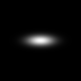
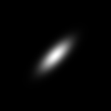

# 高斯参数、协方差与空间响应

[项目总览](README.md) · [上一专题](01_Representation_and_Renderer_Interface.md) · [下一专题：相机投影](03_Camera_Projection_and_Screen_Footprint.md)

一个三维高斯需要分别描述中心和形状。中心 $\mu$ 决定它在哪里，协方差 $\Sigma$ 决定各方向上的伸展；颜色与 opacity 不改变纯几何响应。

## 从尺度与旋转构造形状

```math
\Sigma_w=R_g\mathrm{diag}(s_x^2,s_y^2,s_z^2)R_g^\top,
\qquad
g(x)=\exp\left[-\frac{1}{2}(x-\mu)^\top\Sigma_w^{-1}(x-\mu)\right].
```

尺度是标准差，所以构造协方差时需要平方；已经激活的尺度不再做 exp。`R_g` 是高斯自身旋转。中心没有包含在协方差内，平移中心不应顺带旋转或缩放协方差。

这里使用未做概率密度归一化的响应，中心值为 1。它不包含颜色和 opacity，不要求在全空间积分等于 1。尺度变大使覆盖范围扩张，不会因 PDF 归一化而把中心响应压低。

## 十组局部实验

实验在世界空间的 XY / XZ 平面上采样 161 × 161 网格。它没有相机、不调用光栅器，也没有训练。

| 参数变化 | 应检查的量 | 本次结论 |
|---|---|---|
| 中心沿 x 平移 | 峰值位置与协方差 | 响应位置移动，形状参数独立 |
| x 轴尺度加倍 | 对应主方向方差 | 标准差加倍意味着该主方向方差乘 4 |
| 全尺度加倍 | 整体空间范围 | 各主轴扩张，中心响应定义不变 |
| 绕 z / y 旋转 | XY / XZ 截面与非对角协方差 | 各向异性形状随自身旋转变化 |
| 各向同性后再旋转 | 协方差、两张切片 | 对照最大绝对差均为 0 |
| 只改 opacity | 几何协方差与切片 | 对照最大绝对差均为 0 |
| 只改颜色 | 几何协方差与切片 | 对照最大绝对差均为 0 |

| 基线 XY 切片 | 绕 z 旋转 45° |
|---|---|
|  |  |

基线与绕 z 旋转对照的协方差最大绝对差为 0.01375；XY 响应最大绝对差约 0.482249，XZ 响应约 0.457419。各向同性旋转对照则没有变化。两种结果并不矛盾：只有具有方向差异的形状，其自身旋转才会改变空间响应。

## 解释时要区分的对象

空间切片不是相机渲染图。它不包含透视缩放、遮挡或背景；一个高斯的几何响应也不等于它最后对像素的颜色权重。颜色和 opacity 不改变这些切片，不表示它们不会改变真实渲染图。

三维协方差的正定性和合法四元数是后续投影的前提。投影需要整块协方差，不能只保留对角线，否则会丢失已经编码的朝向。

## 证据与验证

[实验报告](results/gaussian_parameters/experiment/experiment_report.json)包含十组设置和配对差异；[形状统计](results/gaussian_parameters/experiment/shape_stats.csv)与各案例 `fields.npz` 保留数值。[CPU 检查](results/gaussian_parameters/checks/check_cpu.json)保存 18 项通过，[可选 CUDA 对照](results/gaussian_parameters/checks/compare_gsplat.json)保存 3 项通过。

这些检查覆盖本地接口与合成用例。它们没有优化场景，也没有验证真实物体表面；如何把形状送入屏幕空间见[投影专题](03_Camera_Projection_and_Screen_Footprint.md)。
