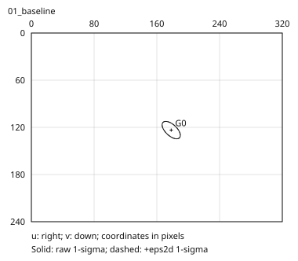
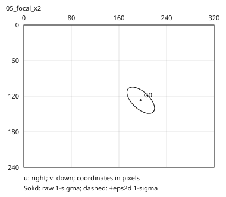

# 相机投影与屏幕椭圆

[项目总览](README.md) · [上一专题](02_Gaussian_Parameters_and_Covariance.md) · [下一专题：遮挡合成](04_Visibility_and_Alpha_Compositing.md)

投影一个高斯，需要同时转换中心和协方差。只移动中心而保留错误坐标系下的协方差，会产生看似合理但朝向或尺度错误的屏幕椭圆。

## 世界到相机

对于 OpenCV world-to-camera $[R_{cw}|t_{cw}]$：

```math
\mu_c=R_{cw}\mu_w+t_{cw},\qquad
\Sigma_c=R_{cw}\Sigma_wR_{cw}^\top.
```

平移作用于中心，协方差只受旋转影响。相机坐标中的有符号 Z 用于深度有效性判断；本地教学契约严格要求 `Z > near`，等于 near 也属于无效。

## 局部一阶投影

设相机中心坐标为 $(X,Y,Z)$，无 skew 内参下：

```math
u=f_xX/Z+c_x,\quad v=f_yY/Z+c_y,\qquad
J=\begin{bmatrix}
f_x/Z&0&-f_xX/Z^2\\
0&f_y/Z&-f_yY/Z^2
\end{bmatrix}.
```

```math
\Sigma_{2d,raw}=J\Sigma_cJ^\top,\qquad
\Sigma_{2d}=\Sigma_{2d,raw}+\epsilon_{2d}I.
```

Jacobian 在高斯中心计算，因此这是局部一阶近似。二维协方差单位为像素平方；本例稳定项为 0.3 像素平方，应只加一次。它对很小的投影足迹影响明显。

## 十组设置的数值观察

以下主轴数值是协方差特征值平方根对应的标准差长度，不是整个高斯的边界半径。

| 对照 | 投影中心 (u,v) | 原始长轴标准差 | 观察 |
|---|---|---:|---|
| 基线 | (178.3333, 123.5000) | 14.3486 px | Z=3 |
| 相机向右 0.35 | (152.6667, 123.5000) | 14.3426 px | 世界不动，图像中心左移 |
| 相机向前 0.60 | (182.9167, 124.3750) | 17.9401 px | Z=2.4，足迹变大 |
| 焦距加倍 | (196.6667, 127.0000) | 28.6972 px | 原始标准差加倍，协方差乘 4 |
| 主点位移 (+30,-20) | (208.3333, 103.5000) | 14.3486 px | 只平移中心，形状不变 |
| 中心沿同一射线远移至 Z=6 | (178.3333, 123.5000) | 7.1743 px | 中心不变，原始标准差减半 |

固定稳定项不会随焦距自动缩放，因此“焦距加倍、协方差乘 4”针对原始投影项，不能直接套到加完稳定项的结果。

| 基线椭圆 | 焦距加倍 |
|---|---|
|  |  |

小足迹对照将世界协方差除以 400：原始长/短轴为 0.71743 / 0.35816 px，加稳定项后为 0.90261 / 0.65443 px。此时不能忽略滤波项。

## 深度、中心与可见性

`valid_depth`、`center_in_image` 和实际像素贡献是不同判断。本例中心越界案例仍有正深度；中心不在图内，不代表整个椭圆足迹都不接触图像。反过来，中心在图内也可能被遮挡或具有极低 opacity。

深度边界组包含 Z=3、-1、0、0.01、0.015；near=0.01 时只有 3 和 0.015 有效。无效行保持明确标记，不用虚构的正深度继续投影。

## 证据与边界

[投影统计](results/projection/experiment/projection_stats.csv)包含十组设置、14 条高斯记录；[实验报告](results/projection/experiment/experiment_report.json)记录原运行和 SVG 白背景展示更新。展示更新未重跑数值实验，NPZ 保持原值。

[CPU 检查](results/projection/checks/check_cpu.json)为 24/24，[CUDA 对照](results/projection/checks/compare_gsplat.json)为 3/3。教学接口没有实现生产光栅器全部 FOV、裁剪和 tile 细节；这些用例不能证明任意输入下与 gsplat 完全相同。
