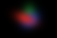
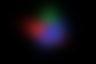

# 遮挡、逐像素 alpha 与前向合成

[项目总览](README.md) · [上一专题](03_Camera_Projection_and_Screen_Footprint.md) · [下一专题：图像拟合](05_Multi_View_Fitting_and_Evaluation.md)

本专题直接使用三个手工屏幕高斯，把投影后的混合单独拿出来验证。图像大小为 96 × 64，没有训练或结构编辑。

## 三个不同的量

基础 opacity 是高斯参数；逐像素 alpha 是 opacity 乘以该像素处的二维响应；最终颜色权重还要乘以前层透射率。

```math
\alpha_i(p)=o_i\exp[-\tfrac12(p-\mu_i)^\top\Sigma_i^{-1}(p-\mu_i)],
\quad T_i(p)=\prod_{j<i}(1-\alpha_j(p)),\quad w_i(p)=T_i(p)\alpha_i(p).
```

第一层之前没有遮挡，因此 $T_1=1$。最后剩余透射率 $R=\prod_i(1-\alpha_i)$ 分配给背景：

```math
C=\sum_iw_ic_i+Rc_{bg},\qquad A=1-R,\qquad\sum_iw_i+R=1.
```

颜色不提前重复乘 opacity，背景只加一次，权重不再归一化。归一化会丢掉背景应占的份额。

## 一个像素的完整记录

基线 `(column,row)=(43,31)`，采样位置 `(43.5,31.5)`：

| 原高斯 ID | camera Z 标签 | alpha | T before | weight |
|---|---:|---:|---:|---:|
| G0 | 2 | 0.750000000000 | 1.000000000000 | 0.750000000000 |
| G1 | 3 | 0.426177730534 | 0.250000000000 | 0.106544432634 |
| G2 | 4 | 0.260742876138 | 0.143455567366 | 0.037405017233 |

residual=0.106050550133；RGB=(0.691265196, 0.170930373, 0.185568465)。G1 自身 alpha 约 0.426178，实际权重只有 0.106544，因为前层已挡住 75%。来源：[逐像素 trace](results/compositing/experiment/01_baseline/pixel_trace.csv)。

## 受控对照的结果

| 改动 | 保存的观察 | 解释 |
|---|---|---|
| 只交换深度标签 | 全图 RGB 最大变化 0.360109；总 alpha / residual 不变 | 顺序改变颜色份额，乘积形式的剩余透射率不变 |
| G0 opacity 降至 0.15 | 该像素 G1 权重从 0.106544 升至 0.362251 | 后层 alpha 没变，前层放行更多 |
| G0 完全透明 | G0 权重为 0，G1 权重等于其自身 alpha | G1 成为第一层有效贡献 |
| G0 协方差乘 4 | 中心像素 alpha 不变，平均权重从 0.068243 升至 0.248697 | 覆盖范围扩张，不使用 PDF 归一化 |
| 黑背景换白背景 | 每通道变化等于 residual，最大恒等式误差约 1.11e-16 | 背景只接收剩余透射率 |
| 只改颜色 | alpha、T、权重、residual 全部不变 | 几何遮挡与颜色值分工明确 |
| 全透明 | alpha=0，residual=1，RGB 完全等于背景 | 空贡献边界成立 |

| 基线顺序 | 交换前两层深度标签 |
|---|---|
|  |  |

交换深度标签没有重新投影，不等于真实移动三维高斯。真实三维移动通常会同时改变投影位置与足迹。十组实验的全图守恒最大误差均不超过 2.22e-16；完整数值见[独立逐像素核对](results/compositing/verified_metrics.json)。

## 理想合成与真实光栅器

教学实现处理全部有效层；固定版本 gsplat 在生产路径上包含 tile 候选、阈值与提前结束。保存的 CUDA 对照选择近似不触发的用例，另有高层三维前向/反向冒烟检查，因此不能将局部一致外推成任意场景逐像素相等。

它与 NeRF 共享“透射率 × alpha”的前向混合结构，但 alpha 的构造不同。NeRF 使用密度和采样区间；这里使用高斯 opacity 与屏幕空间响应。相同的混合形式不意味着场景表示或渲染数值等价。

[CPU 报告](results/compositing/checks/check_cpu.json)保存 24 项通过，[CUDA 对照](results/compositing/checks/compare_gsplat.json)保存 4 项通过。实验和检查没有执行优化器更新；图像拟合另见下一专题。
