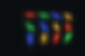
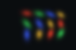

# 多视角拟合、参数更新与保留视角评估

[项目总览](README.md) · [上一专题](04_Visibility_and_Alpha_Compositing.md) · [下一专题：结构控制](06_Density_Control_and_Optimizer_State.md)

渲染器能反传，只说明存在可用梯度；持续更新是否降低误差，要通过实际训练和保留视角评估判断。本模块用同一初始化比较“只调颜色”和“五组参数一起调”。

## 数据和实验单位

数据由 12 个已知生成高斯经同一 gsplat 渲染器产生，包含 7 个 96 × 64 视角。初始化是生成场景附近的固定扰动，seed=42；数据包不包含 teacher 参数。训练视角为 `[0,2,3,4,6]`，验证为 `[1,5]`，背景 RGB 为 `(0.04,0.05,0.06)`。

这是一项接近正确解的合成自一致性实验。它适合检查表示、可微渲染和优化接口，但与从真实照片及未知相机开始的场景重建有明显差别。数据身份和原始目标见[场景清单](results/dataset/dataset_manifest.json)及[scene.npz](results/dataset/scene.npz)。

## 同起点的参数对照

| 条件 | 可训练参数 | 固定部分 | 更新数 |
|---|---|---|---:|
| appearance | color_logits | 位置、旋转、尺度、opacity、相机、数量 | 600 |
| joint | means、quats、log_scales、opacity_logits、color_logits | 相机与数量 | 600 |

两组从同一初始化各自开始，训练视角按同样的 round-robin 顺序轮流输入，每个训练视角使用 120 次。优化器为 Adam，学习率依次为 means=0.005、quats=0.005、log_scales=0.01、opacity_logits=0.02、color_logits=0.03。

训练损失是所有 RGB 标量的 MSE。不使用几何真值、SSIM 或验证损失更新参数；最终保存 LAST，不根据验证结果选 best。这里的 joint 同时解冻多组参数，不能将收益单独归因于位置或协方差。

## 保存的结果

| 阶段 | Train MSE | Val MSE | Val PSNR |
|---|---:|---:|---:|
| 共同初始化 | 3.74472259e-3 | 3.74176269e-3 | 24.2692 dB |
| appearance final | 3.03472950e-3 | 3.03288292e-3 | 25.1814 dB |
| joint final | 4.37764257e-6 | 4.37484701e-6 | 53.5904 dB |

仅调颜色改善有限。联合优化明显降低误差，同时五组参数都实际变化，保存的 L2 变化量分别为 0.512113、0.417011、0.821252、0.864484、2.855737。参数发生变化不等于它们恢复了真实三维形状，仍需要额外几何真值才能评价。

| 目标 | 仅颜色优化 | 联合优化 |
|---|---|---|
|  |  |  |

来源：[appearance 训练报告](results/training/appearance/training_report.json)、[joint 训练报告](results/training/joint/training_report.json)。逐步训练数据保存在对应 `train_log.csv` 中，最终完整七视角浮点预测保存在 `final/rgb_float.npz`。

## 统一的指标口径

```math
\mathrm{SSE}=\sum_{v,p,c}(\hat C_{vpc}-C_{vpc})^2,\qquad
\mathrm{MSE}=\frac{\mathrm{SSE}}{\text{RGB scalar count}},\qquad
\mathrm{PSNR}=-10\log_{10}(\mathrm{MSE}).
```

预测和目标先转换为 float64，再相减累计。训练分母为 92,160，验证分母为 36,864。计算前不 clip、不量化，也不平均逐图 PSNR；PNG 只用于展示。精确零 MSE 使用 `psnr_db=null` 和 `psnr_is_infinite=true` 表达。

全图 MSE 包含背景，因此另保存 target-contrast 诊断区域：目标与背景的最大通道差大于 0.03 的像素。该区域在验证集中共 4,869 个像素，属于颜色对比掩码，不是真实前景标签。

| 条件 | Val 全图 MSE | Val 对比区域 MSE |
|---|---:|---:|
| appearance | 3.03288292e-3 | 7.46457863e-3 |
| joint | 4.37484701e-6 | 1.09442810e-5 |

## 独立重载与解释边界

两组在新进程中分别重载 checkpoint 并评估，保存 RGB 与训练最终输出的最大差异均为 0。[appearance 重载报告](results/training/appearance_reload/evaluation_report.json)和[joint 重载报告](results/training/joint_reload/evaluation_report.json)单独提供证据。训练报告内 `independent_reload_evaluated=false` 表示训练脚本当时尚未执行这个后续步骤，不代表独立重载没有完成。

验证相机没有参与优化，但它们与训练相机相邻；本例也只有一个 seed、一个小场景。高 PSNR 表明这个评估范围内图像拟合良好，不能推断背面、大范围新视角、真实几何或动态能力。下一专题从同一 joint LAST 和 Adam 状态开始，隔离继续训练与结构编辑的影响。
