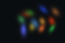
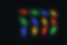
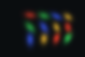
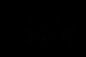

# 3D Gaussian Splatting

**从显式高斯、相机投影与遮挡合成，到多视角拟合、受控分裂与冻结场景验证。**

本项目围绕“一个高斯怎样成为像素、图像误差怎样更新场景、结构编辑怎样改变拟合结果”组织实验。在 7 个 96 × 64 合成视角上，12 个高斯经过联合优化，在两个保留验证视角上达到 **53.59 dB PSNR**。从同一模型和 Adam 状态各续训 300 步后，自适应方案通过一次分裂事件将高斯数增至 14，验证 MSE 比固定数量对照降低 **59.74%**。

这是 World Model 系列的 Week 4 总结项目，延续 [NeRF 项目](https://github.com/Allgames817/WM_Week3_Neural_Radiance_Fields)的展示结构，按技术主题组织说明、精选图和原始证据。本例目标图由同一渲染器生成，初始化接近已知生成场景；这些结果描述小型合成任务，不代表真实照片重建性能。

[专题导航](#专题导航) · [实验结果](#实验结果) · [证据索引](SOURCE_INDEX.md) · [归档校验](results/PACKAGE_CHECKS.md) · [方法来源](SOURCES.md)

## 结果预览

| 保留视角 1 的目标 | 初始预测 | 仅颜色优化 | 联合优化 |
|---|---|---|---|
|  |  |  |  |

图像原始分辨率为 96 × 64，放大仅用于浏览。表中指标来自两个验证视角的全部浮点 RGB；PNG 经过显示量化，不用于评分。平滑的彩色高斯就是本实验的目标内容。

## 项目实现了什么

- **显式场景表示**：明确均值、四元数、尺度、不透明度与颜色的形状及激活边界，以旋转和尺度构造三维协方差。
- **几何到像素**：相机变换、局部投影 Jacobian、二维椭圆、深度排序、逐像素 alpha、前向透射率和背景合成。
- **图像监督拟合**：同初始化、同相机顺序、同更新步数的仅颜色与联合优化对照，保存独立重载结果。
- **结构与优化器同步编辑**：受控选择 clone / split / prune，追踪参数行身份，保留旧行 Adam 历史并清零新行矩。
- **独立验证**：NumPy 几何/合成接口、保存浮点指标复算、冻结模型 A→B→A 和局部相机轨迹。

## 技术流程

```text
raw Gaussian parameters
        │ activation / quaternion convention
        ▼
means + covariance + opacity + RGB
        │ OpenCV world-to-camera + intrinsics
        ▼
projected centers + 2D covariance
        │ depth order + per-pixel Gaussian response
        ▼
alpha → transmittance → weighted RGB + background
        │ RGB MSE / training cameras only
        ▼
Adam updates → optional split / clone / prune
        │ parameter-row and optimizer-state migration
        ▼
held-out evaluation / reload / frozen replay / audit
```

三维形状由 $\Sigma_w=R(q)\mathrm{diag}(s^2)R(q)^\top$ 表示。投影后的高斯响应给出逐像素 alpha；按前后顺序合成：

```math
\alpha_i(p)=o_i\exp\left[-\frac{1}{2}(p-\mu_i)^\top\Sigma_{2d,i}^{-1}(p-\mu_i)\right],
\qquad T_i(p)=\prod_{j\lt i}(1-\alpha_j(p)).
```

```math
\hat C(p)=\sum_i T_i(p)\alpha_i(p)c_i+
\left[\prod_i(1-\alpha_i(p))\right]c_{bg}.
```

这里展示教学理想形式；真实训练使用固定版本 gsplat，包含其生产光栅化细节。

## 实验设置

| 项目 | 配置 |
|---|---|
| 数据 | 本地生成的 7 个合成视角，96 × 64；seed 42 |
| 划分 | 训练 `[0,2,3,4,6]`；验证 `[1,5]` |
| 相机 | 固定 OpenCV w2c；每张图使用对应内参；不优化相机 |
| 模型 | 初始 12 个高斯；直接 RGB，`sh_degree=None` |
| 渲染 | gsplat classic / pinhole / packed=False；eps2d=0.3，near=0.01，far=10 |
| 基础拟合 | appearance 仅颜色；joint 优化五组原始参数；各 600 步 |
| 续训对照 | 同一 joint LAST 和 Adam 状态；fixed / adaptive 各追加 300 步 |
| 评估 | 浮点 RGB 汇总 SSE / 标量数，再计算 peak=1 PSNR；使用 LAST |
| 历史环境 | Windows、Python 3.10.22、PyTorch 2.4.1+cu124、gsplat 1.5.3+pt24cu124、RTX 4060 Laptop GPU |

合成场景与评估目标随包收录；完整训练源码和 Torch checkpoint 未分发。本仓库支持结果审阅与指标复核，重新训练仍需原工作区。

## 实验结果

| 条件 | 累计更新 | 高斯数 | Train MSE ↓ | Val MSE ↓ | Val PSNR ↑ |
|---|---:|---:|---:|---:|---:|
| 共同初始化 | 0 | 12 | 3.74472259e-3 | 3.74176269e-3 | 24.2692 dB |
| 仅颜色 appearance | 600 | 12 | 3.03472950e-3 | 3.03288292e-3 | 25.1814 dB |
| 联合优化 joint | 600 | 12 | 4.37764257e-6 | 4.37484701e-6 | 53.5904 dB |
| 固定数量续训 fixed | 900 | 12 | 4.43729359e-6 | 4.42021577e-6 | 53.5456 dB |
| 自适应续训 adaptive | 900 | 14 | 1.79606665e-6 | **1.77948648e-6** | **57.4971 dB** |

来源：[浮点审计表](results/validation/reconciliation/metrics_table.csv)、[配对续训报告](results/density_control/comparison/comparison.json)。验证指标先累计 36,864 个 RGB 标量，不平均逐视角 PSNR。

**本次分裂配合继续训练改善了验证误差，分裂动作本身没有立即改善图像。** 唯一实际编辑发生于续训第 50 步：2 个父高斯变为 4 个子高斯，验证 MSE 从 4.31417e-6 暂时升至 1.29954e-4，之后优化才将误差降低。训练期间 clone=0、prune=0；其机制由独立强制编辑实验验证。

| 固定数量续训 | 自适应续训 | 自适应绝对误差 |
|---|---|---|
|  |  |  |

误差图未放大，统一使用 `[0,1]` 显示范围；肉眼近似不能替代浮点比较。

## 专题导航

| 专题 | 核心问题 | 说明 |
|---|---|---|
| 01 表示与接口 | 从 NeRF 到显式高斯，哪些接口保留 | [Representation and Renderer Interface](01_Representation_and_Renderer_Interface.md) |
| 02 高斯形状 | 位置、尺度、旋转怎样决定响应 | [Gaussian Parameters and Covariance](02_Gaussian_Parameters_and_Covariance.md) |
| 03 相机投影 | 三维协方差怎样成为屏幕椭圆 | [Camera Projection and Screen Footprint](03_Camera_Projection_and_Screen_Footprint.md) |
| 04 遮挡合成 | alpha、透射率、权重和背景怎样关联 | [Visibility and Alpha Compositing](04_Visibility_and_Alpha_Compositing.md) |
| 05 多视角拟合 | 图像误差怎样更新场景，怎样评估 | [Multi-View Fitting and Evaluation](05_Multi_View_Fitting_and_Evaluation.md) |
| 06 结构控制 | 如何增删高斯并同步 Adam 状态 | [Density Control and Optimizer State](06_Density_Control_and_Optimizer_State.md) |
| 07 独立验证 | 如何核对结果、冻结重放并衔接几何估计 | [Independent Validation and Geometry Bridge](07_Independent_Validation_and_Geometry_Bridge.md) |

## 仓库结构与复核

```text
WM_Week4_3D_Gaussian_Splatting/
├── README.md
├── 01_*.md … 07_*.md       # 技术专题
├── figures/                # 原图精选，未修改数值或显示范围
├── results/
│   ├── renderer_entry/     # 渲染入口与环境
│   ├── gaussian_parameters/# 参数切片
│   ├── projection/         # 投影与椭圆
│   ├── compositing/        # 排序、逐像素权重与背景
│   ├── dataset/            # 本地合成数据与目标
│   ├── training/           # appearance / joint
│   ├── density_control/    # fixed / adaptive / 强制编辑
│   ├── validation/         # 独立接口、指标审计、冻结轨迹
│   └── package_validation/ # 本次整理的校验
├── SOURCE_INDEX.md
└── SOURCES.md
```

阅读不需要 GPU。仓库保留浮点预测、合成目标、固定划分和指标报告，可按[评估口径](05_Multi_View_Fitting_and_Evaluation.md)自行复算。整理时的哈希、链接及指标检查结果见[归档校验](results/PACKAGE_CHECKS.md)；校验工具仅在本地使用，不随仓库分发。

下载仓库后，打开 [adaptive 轨迹 HTML](results/validation/adaptive_review/index.html)可浏览保存的 61 帧局部往返轨迹；GitHub 文件页不会执行该 HTML。完整过程没有在线训练或状态更新。

## 结论与边界

本项目将显式场景的表示、几何、渲染、优化和验证连成一条可追溯的链路。实测支持同一小型合成场景中的局部保留视角拟合、受控分裂后的继续优化和固定参数重复渲染。

实验只有单场景、单种子和近解初始化；目标与预测使用同一种渲染器，验证相机与训练相机相邻，全图 MSE 包含背景。高 PSNR 不证明真实三维几何唯一正确。未验证真实照片重建、大范围新视角、动态物体、在线空间记忆或动作条件未来预测；VGGT 仅作为下一阶段接口方向。
